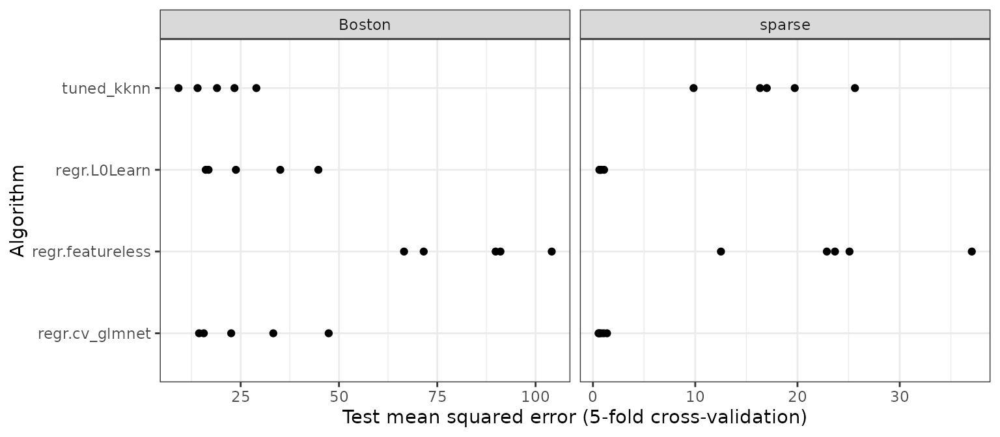

# Benchmark of regr.L0Learn

This vignette compares `regr.L0Learn` with a featureless baseline, a
lasso linear model (`regr.cv_glmnet`) and k-nearest neighbors with the
number of neighbors tuned between 1 and 30, using 5-fold
cross-validation on two data sets with numeric features only.

``` r

library(mlr3)
library(mlr3learners)
library(mlr3tuning)
library(mlr3L0Learn)
library(data.table)
library(ggplot2)
lgr::get_logger("mlr3")$set_threshold("warn")
lgr::get_logger("bbotk")$set_threshold("warn")
```

## Data sets

The first data set is simulated: 200 rows, 50 features, and only the
first 5 features have a non-zero coefficient. The second is the real
`Boston` housing data from the `MASS` package (506 rows, 13 numeric
features), where the target is the median home value.

``` r

set.seed(1)
n_rows <- 200
n_features <- 50
x_mat <- matrix(
  rnorm(n_rows * n_features), n_rows, n_features,
  dimnames = list(NULL, sprintf("x%02d", seq_len(n_features))))
y_vec <- as.numeric(x_mat[, 1:5] %*% rep(2, 5) + rnorm(n_rows))
sparse_task <- as_task_regr(
  data.frame(y = y_vec, x_mat), target = "y", id = "sparse")
boston_task <- as_task_regr(MASS::Boston, target = "medv", id = "Boston")
task_list <- list(boston_task, sparse_task)
```

## Learners

``` r

knn_tuner <- auto_tuner(
  tuner = tnr("grid_search"),
  learner = lrn("regr.kknn", k = to_tune(1, 30)),
  resampling = rsmp("cv", folds = 3),
  measure = msr("regr.mse"))
knn_tuner$id <- "tuned_kknn"
learner_list <- list(
  lrn("regr.L0Learn", nFolds = 5L),
  lrn("regr.featureless"),
  lrn("regr.cv_glmnet"),
  knn_tuner)
```

## Cross-validation

``` r

set.seed(1)
bench_grid <- benchmark_grid(task_list, learner_list, rsmp("cv", folds = 5))
bench_result <- benchmark(bench_grid)
score_dt <- bench_result$score(msr("regr.mse"))
score_dt[, .(mean_mse = mean(regr.mse), sd_mse = sd(regr.mse)),
  by = .(task_id, learner_id)]
#>    task_id       learner_id   mean_mse     sd_mse
#>     <char>           <char>      <num>      <num>
#> 1:  Boston     regr.L0Learn 27.3156722 12.3689881
#> 2:  Boston regr.featureless 84.6229527 15.3779285
#> 3:  Boston   regr.cv_glmnet 26.6650639 13.7971665
#> 4:  Boston       tuned_kknn 18.9266167  7.7502699
#> 5:  sparse     regr.L0Learn  0.7850789  0.1845453
#> 6:  sparse regr.featureless 24.2370484  8.7235604
#> 7:  sparse   regr.cv_glmnet  0.8768506  0.3407752
#> 8:  sparse       tuned_kknn 17.7060683  5.7213560
```

``` r

ggplot(score_dt, aes(x = regr.mse, y = learner_id)) +
  geom_point() +
  facet_grid(. ~ task_id, scales = "free") +
  labs(x = "Test mean squared error (5-fold cross-validation)", y = "Algorithm") +
  theme_bw()
```



## Number of selected features

L0 penalization is designed to give sparse models. The table counts the
features with a non-zero coefficient when each learner is trained on all
the rows of each data set.

``` r

count_dt <- rbindlist(lapply(task_list, function(task) {
  l0 <- lrn("regr.L0Learn", nFolds = 5L)$train(task)
  glmnet_learner <- lrn("regr.cv_glmnet")$train(task)
  data.table(
    task_id = task$id,
    n_features = length(task$feature_names),
    L0Learn = length(l0$selected_features()),
    cv_glmnet = length(glmnet_learner$selected_features()))
}))
count_dt
#>    task_id n_features L0Learn cv_glmnet
#>     <char>      <int>   <int>     <int>
#> 1:  Boston         13       3         7
#> 2:  sparse         50       8         9
```
